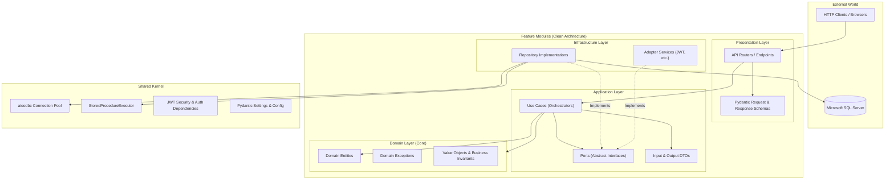
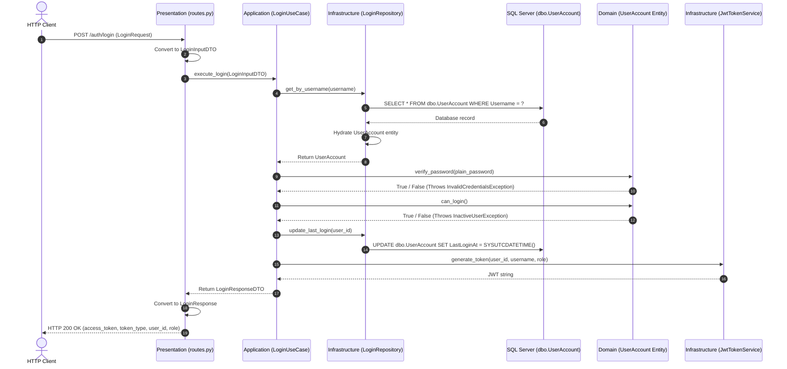
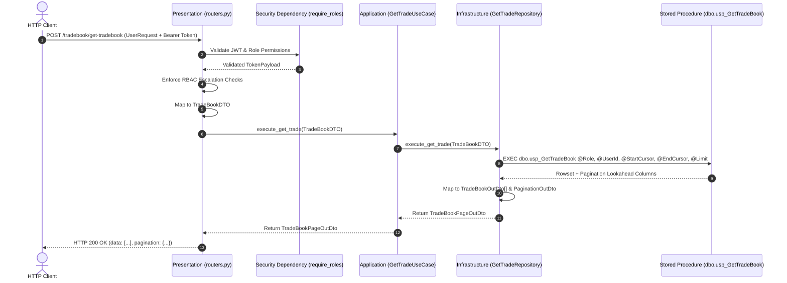

# System Architecture & Technical Specification

## 1. Executive Overview

The **Ingestion Engine & TradeBook Platform** is an enterprise-grade financial trade processing, simulated ingestion, and query system built with **FastAPI**, **Python 3.13**, **aioodbc**, and **Microsoft SQL Server**.

The project is structured according to **Clean Architecture** (also known as Hexagonal Architecture or Ports & Adapters) combined with **Feature-Driven Modularization**. Each major capability is isolated into its own self-contained feature module with strict unidirectional dependency rules.



---

## 2. Core Architectural Principles

### 2.1 The Dependency Rule
Dependencies **strictly point inward**:
1. **Domain Layer** is the core. It has **zero dependencies** on external libraries, frameworks, or databases.
2. **Application Layer** depends only on the Domain Layer. It defines abstract **Ports** (interfaces) and DTOs.
3. **Infrastructure Layer** depends on Application Ports and Domain Entities, implementing database and third-party integrations.
4. **Presentation Layer** depends on Application Use Cases and Schemas, handling HTTP transport and response formatting.

### 2.2 Ports & Adapters (Dependency Inversion)
Application Use Cases never instantiate or depend on concrete infrastructure classes (like database connections or token libraries). Instead:
* Application defines abstract contracts (**Ports**): e.g. `ILoginRepository`, `ITokenService`, `IGetTradesRepository`.
* Infrastructure provides concrete implementations (**Adapters**): e.g. `LoginRepository`, `JwtTokenService`, `GetTradeRepository`.
* Presentation wires dependencies together using FastAPI's dependency injection (`Depends`).

### 2.3 Strict DTO Decoupling & Zero Entity Leakage
* **HTTP Schemas** (`LoginRequest`, `UserRequest`, `LoginResponse`) belong strictly to the **Presentation Layer**.
* **Application DTOs** (`LoginInputDTO`, `TradeBookDTO`, `TradeBookPageOutDto`) decouple Use Cases from HTTP transport.
* **Domain Entities** (`UserAccount`, `Trade`) **never leak into the Presentation Layer**. They are converted into dedicated Output DTOs before leaving the Use Case, preventing sensitive internal state (such as password hashes) from escaping.

---

## 3. Directory Structure

```text
ingestion_engine/
├── architecture.md                     # System architecture specification
├── pyproject.toml                      # Package dependencies & configuration
├── .env                                # Environment configurations (DATABASE_URI, secrets)
├── sql/
│   └── SP_Query.sql                    # T-SQL Stored Procedure (dbo.usp_GetTradeBook)
├── scripts/
│   └── monitor_api_tradebook.py        # Real-time CLI verification & monitoring script
├── tests/
│   ├── test_auth_flow.py               # Authentication integration & unit tests
│   ├── test_connection.py              # Database pool connectivity tests
│   ├── test_ingestion_api.py           # Ingestion API endpoints tests
│   ├── test_ingestion_engine.py        # Background engine unit tests
│   └── test_tradebook_rbac.py          # RBAC privilege & security isolation tests
└── src/
    ├── app.py                          # FastAPI application factory & lifespan context
    ├── shared/                         # Cross-cutting infrastructure kernel
    │   ├── config/
    │   │   └── settings.py             # Pydantic BaseSettings environment loader
    │   ├── database/
    │   │   ├── connection.py           # aioodbc Connection Pool lifecycle manager
    │   │   └── sp_executor.py          # Asynchronous Stored Procedure runner
    │   └── security/
    │       ├── jwt.py                  # HMAC-SHA256 JWT encoding, decoding & payload
    │       └── dependencies.py         # FastAPI security dependencies (require_roles)
    ├── ingestion_engine/               # Core background trade simulator
    │   ├── config.py                   # Seed dealers, instruments & exchange configs
    │   └── engine.py                   # TradeIngestionEngine async background worker
    └── features/                       # Modular Clean Architecture Features
        ├── Auth/                       # Authentication & Authorization Feature
        │   ├── Domain/
        │   │   ├── entities/user_account.py
        │   │   └── exceptions.py
        │   ├── Application/
        │   │   ├── ports/
        │   │   │   ├── LoginRepository.py
        │   │   │   └── TokenService.py
        │   │   ├── DTO/
        │   │   │   ├── Input/LoginDTO.py
        │   │   │   └── Output/LoginResponseDTO.py
        │   │   └── use_cases/LoginUseCase.py
        │   ├── Infrastructure/
        │   │   ├── repositories/LoginRepository.py
        │   │   └── services/JwtTokenService.py
        │   └── Presentation/
        │       ├── schemas/LoginData.py
        │       └── routes.py
        ├── Tradebook/                  # Trade Query & Keyset Pagination Feature
        │   ├── Domain/
        │   │   ├── entities/
        │   │   │   ├── Trade.py
        │   │   │   └── Paginationdata.py
        │   │   └── exceptions.py
        │   ├── Application/
        │   │   ├── ports/GetTradesRepository.py
        │   │   ├── DTO/
        │   │   │   ├── Inputs/
        │   │   │   │   ├── UserdataDTO.py
        │   │   │   │   ├── BiDirectionalPaginationDTO.py
        │   │   │   │   └── TradeBookDTO.py
        │   │   │   └── Outputs/
        │   │   │       └── TradeBookOutDto.py  # OutDto, PaginationOutDto, TradeBookPageOutDto
        │   │   └── use_cases/get_trade.py
        │   ├── Infrastructure/
        │   │   └── repositories/get_trade.py
        │   └── Presentation/
        │       ├── schemas/UserRequest.py
        │       └── routers.py
        └── Ingestion/                  # Ingestion Control API Feature
            └── Presentation/
                └── routes.py           # /ingestion/start, /stop, /status, /generate-sample
```

---

## 4. Feature Deep Dives

### 4.1 Authentication Feature (`src/features/Auth`)

Handles user authentication against `dbo.UserAccount`, password verification, and scoped JWT issuance.

#### Domain Logic & Security
* Passwords are stored in the database as **64-byte binary SHA-512 hashes**.
* Verification uses `hmac.compare_digest` in `UserAccount.verify_password()` to prevent timing attacks.
* User status is checked via `UserAccount.can_login()`.

#### Flow of Control


---

### 4.2 TradeBook Feature (`src/features/Tradebook`)

Provides RBAC-governed tradebook browsing with **keyset bidirectional pagination**.

#### RBAC Authorization Model
| User Role | Query Bounds & Restrictions |
| :--- | :--- |
| **`ADMIN`** | Unrestricted access across all dealers, brokers, and accounts. Can impersonate views by passing target `role` / `userid`. |
| **`BROKER`** | Strictly restricted to trades where `AccountCode = @AccountCode`. Cannot query other accounts. |
| **`DEALER`** | Strictly restricted to trades where `UserID = current_user.sub`. Cannot query other dealers. |
| **`GROUP`** | Governed by `dbo.Config_DealerMap`: allowed to view trades only for dealers and accounts mapped to `GroupCode`. |

Any attempt by non-admin roles to escalate privileges or access unauthorized resources triggers domain exceptions (`PrivilegeEscalationException`, `UnauthorizedUserAccessException`) mapped to HTTP `403 Forbidden`.

#### Keyset Bidirectional Pagination & Lookahead
Instead of expensive `OFFSET / FETCH` scans, pagination uses the clustered index on `tbTradeBook.id`:
* **Next Page (Forward Seek)**: `id < @EndCursor ORDER BY id DESC`
* **Previous Page (Backward Seek)**: `id > @StartCursor ORDER BY id ASC`
* **Lookahead Query**: The stored procedure fetches `@Limit + 1` rows to detect whether further pages exist (`HasNext` / `HasPrev`) without executing an additional `COUNT(*)` query.

#### Response Structure
Responses separate row data from pagination metadata:
```json
{
  "data": [
    {
      "trade_id": 4115,
      "member_code": "MEM001",
      "symbol": "FINNIFTY",
      "quantity": 40,
      "price": "159.590000",
      "trade_time": "2026-10-13 09:05:26.567"
    }
  ],
  "pagination": {
    "cursor_start": 4115,
    "cursor_end": 4111,
    "has_prev": false,
    "has_next": true
  }
}
```

#### Flow of Control


---

### 4.3 Ingestion Feature (`src/features/Ingestion` & `src/ingestion_engine`)

A background trade generator producing realistic trade activity for stress testing, demonstration, and throughput validation.

* **Seed Identity Enforcement**: Trades are strictly assigned to valid dealers, terminals, account codes, and group mappings defined in `dbo.Config_DealerMap`.
* **State Synchronization**: On startup, `TradeIngestionEngine` inspects `MAX(MainTradeID)` in `tbTradeBook` to ensure strictly monotonically increasing IDs.
* **Controlled Lifecycle**: Managed in FastAPI's `lifespan` context or controlled dynamically via HTTP endpoints:
  - `POST /ingestion/start`: Launches background worker loop with configurable batch size and interval.
  - `POST /ingestion/stop`: Cancels and gracefully awaits task shutdown.
  - `GET /ingestion/status`: Reports runtime metrics (trades/sec, total inserted, last trade details).
  - `POST /ingestion/generate-sample`: Synchronously inserts $N$ trades and returns them in the API format.

---

## 5. Shared Infrastructure & Foundation

### 5.1 Asynchronous Database Connection Pooling (`Database`)
* Located at [`src/shared/database/connection.py`](file:///d:/ingestion_engine/src/shared/database/connection.py).
* Wraps **`aioodbc`** connected to Microsoft SQL Server via `ODBC Driver 18 for SQL Server`.
* Pool configurations: `minsize=5`, `maxsize=20`, `autocommit=True`.
* Exposes context managers:
  - `acquire_connection()`: Safely checks out and returns connections.
  - `acquire_cursor()`: Context manager acquiring both connection and cursor, guaranteeing cleanup upon block exit.

### 5.2 Stored Procedure Executor (`StoredProcedureExecutor`)
* Located at [`src/shared/database/sp_executor.py`](file:///d:/ingestion_engine/src/shared/database/sp_executor.py).
* Automatically parameterizes execution statements: `EXEC procedure_name @param1 = ?, @param2 = ?`.
* Maps raw cursor output rows to clean Python dictionaries keyed by column name.

### 5.3 JWT Security & RBAC Middleware
* [`src/shared/security/jwt.py`](file:///d:/ingestion_engine/src/shared/security/jwt.py): Issues and verifies HMAC-SHA256 signed JWT tokens containing claims: `sub`, `user_id`, `role`, and expiration timestamp `exp`.
* [`src/shared/security/dependencies.py`](file:///d:/ingestion_engine/src/shared/security/dependencies.py): Provides reusable FastAPI dependencies:
  - `get_current_user`: Validates `Authorization: Bearer <token>` and extracts user claims.
  - `require_roles(["ADMIN", "BROKER", ...])`: Enforces endpoint-level RBAC role authorization.

---

## 6. Performance & Latency Profile

Empirical benchmarks conducted on local SQL Server with 2,000 returned records:

| Layer | Benchmark | Details |
| :--- | :--- | :--- |
| **SQL Engine Execution** | **~80 – 170 ms** | Direct stored procedure execution via `aioodbc` connection pool. |
| **Repository & DTO Mapping** | **~105 – 125 ms** | SP execution + parsing 2,000 rows into `TradeBookOutDto` objects. |
| **End-to-End HTTP API** | **~145 – 220 ms** | Full roundtrip: JWT authentication + RBAC validation + DB execution + Pydantic serialization of 409 KB payload. |

### Note on SSMS Client Rendering Discrepancy
When benchmarking `dbo.usp_GetTradeBook` in SQL Server Management Studio (SSMS), `STATISTICS TIME` may report elapsed times of **6+ seconds** despite CPU time being only **78 ms**. This is caused by SSMS GUI client rendering (`ASYNC_NETWORK_IO` wait state while drawing 56,000 cells in the Results Grid). In production and via the Python ODBC driver, network streaming completes in under **180 ms**.

---

## 7. Testing Strategy

The repository contains an automated test suite executed with Python's standard `unittest` framework:

```bash
python -m unittest discover tests
```

* **`test_auth_flow.py`**: Verifies login success, bad password rejection, inactive user blocking, and JWT verification.
* **`test_tradebook_rbac.py`**: Validates role isolation (dealers cannot view other dealers; brokers cannot view other accounts; dealers/brokers cannot escalate to admin).
* **`test_ingestion_engine.py`**: Tests generator step executions, seed mappings, and counter synchronization.
* **`test_ingestion_api.py`**: Verifies ingestion lifecycle HTTP endpoints and authorization guards.
