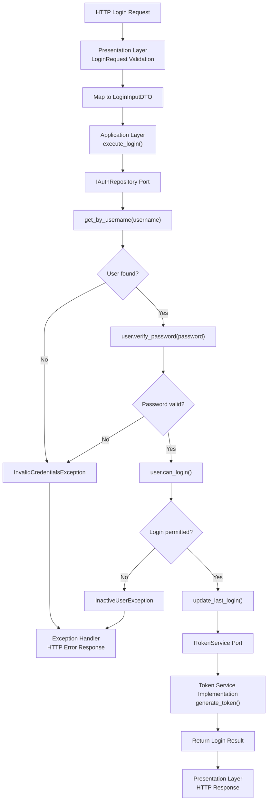

## API REQUEST LIFECYCLE — LOGIN

The login API follows a layered architecture in which the Presentation Layer handles HTTP requests and validation, the Application Layer orchestrates the authentication use case, and infrastructure components handle database operations.

### Request Flow

1. **Presentation Layer**
   - Receives the HTTP login request.
   - Validates the request payload using the `LoginRequest` Pydantic input schema.
   - Maps the validated input to `LoginInputDTO`.

2. **Application Layer**
   - Executes the `execute_login()` use case.
   - Coordinates authentication by using the `IAuthRepository` and `ITokenService` ports.

3. **Authentication Repository**
   - Retrieves the user using `get_by_username(username)`.
   - Raises `InvalidCredentialsException` if the user does not exist.
   - Verifies the supplied password using `user.verify_password(password)`.
   - Raises `InvalidCredentialsException` if password verification fails.
   - Checks `user.can_login()` and raises `InactiveUserException` if the account is not permitted to log in.
   - Updates the last-login information using `update_last_login()` after the authentication checks succeed.

4. **Token Service**
   - Uses the `ITokenService` port to invoke the token-generation implementation.
   - Generates the authentication token using `generate_token()` after the required checks and repository operations succeed.

5. **Response Handling**
   - Returns token from the generate_token() service and `UserAccount` domain entity from the get_by_username repository.
   - Returns the login result as `LoginResponseDTO` from the use case with token and UserAccount attributes.
   - Maps the result to the appropriate HTTP response `LoginResponse` pydantic model in the Presentation Layer.
   - Converts raised exceptions into the appropriate HTTP error responses through the application's exception-handling mechanism.

### Flowchart

### Architectural Notes

- **Separation of concerns:** Each layer has a distinct responsibility.
- **Dependency inversion:** The application use case depends on abstractions (`IAuthRepository` and `ITokenService`) rather than concrete implementations.
- **JWT Payload:** The JWT payload consists of "sub": username,"user_id": user_id,"role": role,"exp": expire,"iat": now to be decoded at the time of access token generation.
- **Data contracts:** `LoginRequest` validates external API input, while `LoginInputDTO` represents application-level input.
- **Consistent error handling:** Invalid credentials and inactive accounts terminate the login flow before the last-login update and token generation.