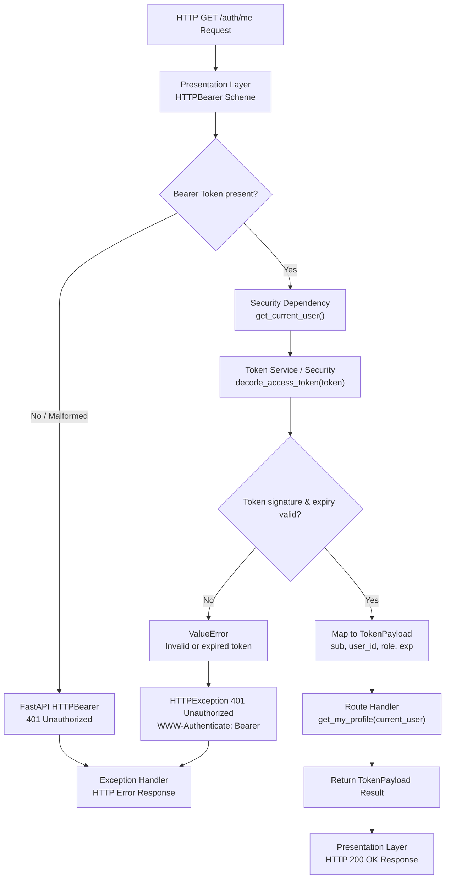

## API REQUEST LIFECYCLE — ME

The `/auth/me` API follows a layered architecture and FastAPI dependency injection pipeline in which the Presentation Layer intercepts the HTTP request, extracts and verifies the bearer token via security dependencies, validates the claims against the `TokenPayload` schema, and returns the authenticated user's profile identity.

### Request Flow

1. **Presentation Layer & HTTP Scheme**
   - Receives the HTTP `GET /auth/me` request.
   - Intercepts the request via FastAPI's `HTTPBearer(auto_error=True)` security scheme (`bearer_scheme`).
   - Validates presence of the `Authorization: Bearer <token>` header, automatically raising HTTP 401 Unauthorized if missing or malformed.
   - Extracts the raw credentials string from `HTTPAuthorizationCredentials`.

2. **Security & Authentication Dependency**
   - Coordinates authentication using the `get_current_user()` dependency.
   - Passes the extracted token string to `decode_access_token()`.

3. **Token Verification & Decoding**
   - Uses `jwt.decode()` with `settings.SECRET_KEY` and algorithm `settings.ALGORITHM` (HS256) to verify token signature and integrity.
   - Checks token expiration (`exp`) against the current UTC timestamp.
   - Catches `jwt.PyJWTError` and raises `ValueError` if the signature is invalid, expired, or malformed.
   - In `get_current_user()`, catches `ValueError` and converts it into `HTTPException` with status code 401 (`HTTP_401_UNAUTHORIZED`) and `WWW-Authenticate: Bearer` challenge header.
   - On successful decoding, instantiates and validates the `TokenPayload` Pydantic model (`sub`, `user_id`, `role`, `exp`).

4. **Route Execution**
   - Injects the authenticated `TokenPayload` model directly into the `get_my_profile()` route handler.
   - Bypasses unnecessary database queries, resolving user identity statelessly from verified token claims.

5. **Response Handling**
   - Returns the authenticated user claims from the `get_my_profile()` handler.
   - Serializes the output using the `response_model=TokenPayload` Pydantic schema.
   - Sends the response with HTTP 200 OK containing user identity (`sub`, `user_id`, `role`, `exp`).
   - Converts raised exceptions into standard HTTP 401 error responses through FastAPI's exception-handling mechanism.

### Mermaid Flowchart

### Architectural Notes

- **Separation of concerns:** The HTTP layer deals only with transport and credentials extraction, the security module handles token cryptographic verification, and the route handler delivers user claims.
- **FastAPI dependency injection:** `get_current_user` cleanly decouples authentication logic from endpoint handlers and enables hierarchical reuse across protected routes.
- **Stateless verification:** The endpoint retrieves user identity directly from signed JWT claims without performing database queries, ensuring low latency.
- **JWT Payload contract:** The decoded claims adhere strictly to `TokenPayload`: `"sub"` (username), `"user_id"` (user ID), `"role"` (`ADMIN`, `BROKER`, `DEALER`, `GROUP`), and `"exp"` (expiration datetime).
- **Foundation for RBAC:** `get_current_user` serves as the underlying dependency for higher-level authorization guards such as `require_roles()` and `get_user_role()`.
- **Consistent error handling:** Missing tokens, expired timestamps, or invalid cryptographic signatures fail fast with HTTP 401 Unauthorized and standard `WWW-Authenticate: Bearer` headers.
