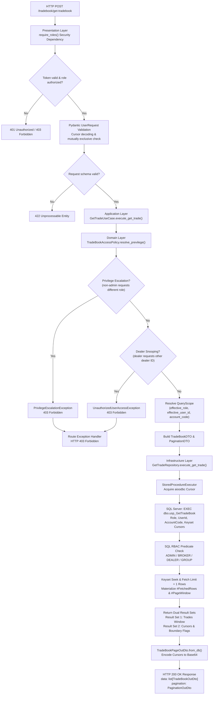

## API REQUEST LIFECYCLE — GET TRADEBOOK

The `/tradebook/get-tradebook` API follows Clean Architecture principles and a layered defense-in-depth pipeline. The Presentation Layer validates the HTTP payload and enforces Bearer JWT authentication; the Application Layer coordinates pagination parameters and delegates authorization to Domain access policies; the Infrastructure Layer executes high-throughput stored procedure queries via a dedicated gateway; and the SQL Database Engine independently enforces row-level security predicates and keyset seek pagination.

---

### Request Flow

1. **Presentation Layer & Authentication Guard**
   - Receives the HTTP `POST /tradebook/get-tradebook` request.
   - Intercepts the request via the `require_roles(["ADMIN", "BROKER", "DEALER", "GROUP"])` security dependency.
   - Decodes and validates the caller's JWT token, ensuring active claims and extracting `TokenPayload` (`sub`, `user_id`, `role`, `exp`).
   - Rejects unauthenticated or unauthorized callers with `HTTP 401 Unauthorized` or `HTTP 403 Forbidden`.
   - Validates the incoming JSON body against the `UserRequest` Pydantic schema:
     - Field aliases accommodate both snake_case and lowercase inputs (`account_code` / `accountcode`, `user_id` / `userid`, `group_code` / `groupcode`).
     - Decodes opaque Base64 pagination cursors (`cursor_start` / `cursor_end`) to integer trade IDs using `decode_cursor()`.
     - Validates that only one cursor is provided per request (`cursor_start` for backward seek, `cursor_end` for forward seek), raising `422 Unprocessable Entity` if both are supplied.
     - Enforces page limit bounds (`10 <= limit <= 5000`, defaulting to `10`).

2. **Application Layer & Use Case Orchestration**
   - Injects dependencies and executes `GetTradeUseCase.execute_get_trade(user_query, current_user)`.
   - Delegates privilege resolution and identity bounding to the Domain policy `TradeBookAccessPolicy.resolve_previlege()`.
   - Maps the resolved `QueryScope` and decoded pagination boundaries into a strongly-typed `TradeBookDTO` containing `UserDataDTO` and `BiDirectionalPaginationDTO`.

3. **Domain Layer Access Policy (`TradeBookAccessPolicy`)**
   - **Role Escalation Defense**: Verifies `current_role == "ADMIN"` if `requested_role != current_role`. Non-admin callers attempting to assume another role immediately raise `PrivilegeEscalationException`.
   - **Dealer Isolation Defense**: Verifies `requested_id == current_id` if `current_role == "DEALER"`. Dealers attempting to view another dealer's tradebook immediately raise `UnauthorizedUserAccessException`.
   - **Effective Scope Bounding**:
     - **`DEALER`**: Hard-locks `effective_user_id = current_id` (the dealer's authenticated code).
     - **`ADMIN`**: Passes `effective_user_id = requested_id or None` with firm-wide query scope.
     - **`BROKER` / `GROUP`**: Passes `effective_user_id = requested_id or None` (allowing whole-account dealer queries or drill-downs into a specific dealer) and binds the target `account_code` / `group_code`.
   - Returns an immutable `QueryScope(effective_role, effective_user_id, group_code, account_code)`.

4. **Infrastructure Layer & Repository Port (`GetTradeRepository`)**
   - Implements the `IGetTradesRepository` port.
   - Constructs parameterized inputs (`Role`, `UserId`, `AccountCode`, `GroupCode`, `StartCursor`, `EndCursor`, `Limit`).
   - Dispatches execution to `StoredProcedureExecutor.execute_result_sets("usp_GetTradeBook", params)`:
     - Acquires an asynchronous connection from the `aioodbc` connection pool.
     - Executes `dbo.usp_GetTradeBook` against `dbo.vw_TradeBook`.
     - Iterates through multiple SQL Server result sets via `cursor.nextset()`.

5. **Database Engine Defense & Keyset Pagination (`dbo.usp_GetTradeBook`)**
   - **Dual-Layer RBAC Predicate**: The SQL `WHERE` clause independently enforces role constraints:
     - `ADMIN`: Global firm-wide visibility (`@Role = 'ADMIN'`).
     - `BROKER`: Bounded to `@AccountCode` and optional `@UserId` dealer filter. Returns 0 rows if `@AccountCode` is null.
     - `DEALER`: Bounded to `TB.UserID = @UserId`.
     - `GROUP`: Joins with `dbo.Config_DealerMap` on `@GroupCode`.
   - **Keyset Direction Detection**:
     - `@StartCursor` provided: Backward pagination (`TB.id > @StartCursor ORDER BY TB.id ASC`).
     - `@EndCursor` provided or initial page: Forward pagination (`TB.id < @EndCursor ORDER BY TB.id DESC`).
   - **Lookahead & Boundary Calculation**:
     - Fetches `Limit + 1` rows into `#FetchedRows` to determine `HasPrev` and `HasNext` without triggering costly `COUNT(*)` full table scans.
     - Trims to `TOP (@Limit)` rows into `#PageWindow`.
     - Returns **Result Set 1**: Page trade records.
     - Returns **Result Set 2**: Single-row pagination metadata (`StartCursor`, `EndCursor`, `HasPrev`, `HasNext`).

6. **Response Handling & Serialization**
   - `TradeBookPageOutDto.from_db(result_sets)` transforms the dual result sets:
     - Maps raw trade dictionaries to `TradeBookOutDto` entities.
     - Encodes pagination boundary trade IDs (`StartCursor`, `EndCursor`) into opaque Base64 strings via `encode_cursor()`.
     - Hydrates `PaginationOutDto` flags (`has_prev`, `has_next`).
   - Returns `TradeBookPageOutDto` serialized as HTTP 200 OK.
   - Any raised `TradebookException` is intercepted by the route exception handler and translated to `HTTP 403 Forbidden`.

---

### Mermaid Flowchart

---

### Architectural Notes

- **Separation of Concerns & Clean Architecture**:
  - **Presentation Layer**: Handles route parameter binding, JWT verification, and Base64 cursor translation.
  - **Application Layer**: Orchestrates use cases and constructs data transfer objects without database knowledge.
  - **Domain Layer**: Enforces pure business policies (`TradeBookAccessPolicy`) and value objects (`encode_cursor`, `decode_cursor`).
  - **Infrastructure Layer**: Connects to the database and dispatches stored procedure calls via `StoredProcedureExecutor`.
- **Dual-Layer Defense-in-Depth**:
  - The application layer intercepts unauthorized access early in memory (`TradeBookAccessPolicy`), avoiding unnecessary database round-trips.
  - The SQL Server stored procedure independently evaluates role predicates (`@Role = 'DEALER' AND TB.UserID = @UserId`, `@Role = 'BROKER' AND TB.AccountCode = @AccountCode`), preventing unauthorized data leakage even if application layers are bypassed.
- **Opaque Keyset Pagination**:
  - Avoids expensive SQL `OFFSET / FETCH` operations by seeking on clustered indexes (`id < @EndCursor` or `id > @StartCursor`).
  - Database IDs are abstracted from the client using opaque Base64 cursor strings, preventing sequential enumeration attacks and leaking internal database keys.
- **Single-Round-Trip Boundary Detection**:
  - Instead of executing an expensive `SELECT COUNT(*)` across millions of trade rows, the query fetches `Limit + 1` rows into `#FetchedRows`, accurately determining `HasNext` / `HasPrev` in the same operation.
- **Dual Result Set Architecture**:
  - Result Set 1 yields exact page rows, while Result Set 2 returns scalar pagination metadata, processed cleanly via `cursor.nextset()`.
- **Fault-Tolerant Input Aliasing**:
  - Pydantic's `AliasChoices` and `ConfigDict(populate_by_name=True)` support both snake_case (`account_code`, `user_id`, `group_code`) and compact naming (`accountcode`, `userid`, `groupcode`), ensuring seamless compatibility across different API clients.
