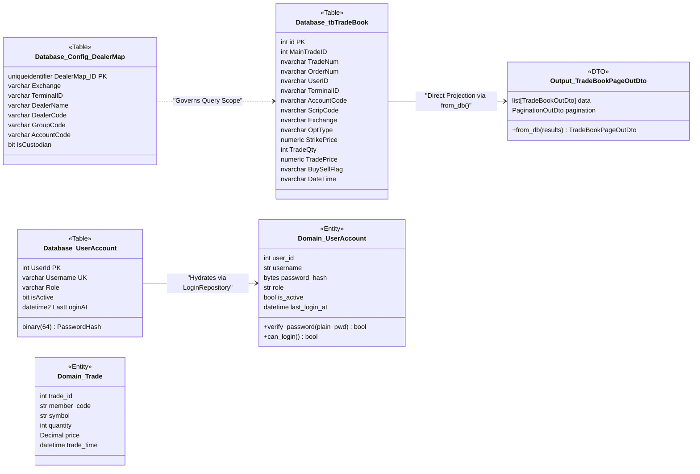
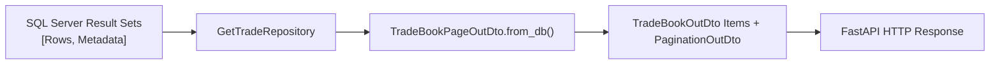

# Database Data Models & Entity Mappings

## 1. Overview of Data Architecture

The data architecture of the Ingestion Engine combines relational storage in **Microsoft SQL Server** with **Domain-Driven Design (DDD)** in the application layer. Data is categorized into three core operational zones:

1. **Transactional Ingestion & Ledger Zone**: [`dbo.tbTradeBook`](file:///d:/ingestion_engine/docs/Database/Datamodels/tbTradeBook.md) serves as an append-mostly, high-throughput trade log populated either in real-time or by the simulated trade generator (`TradeIngestionEngine`).
2. **Organizational Hierarchy & Partitioning Zone**: [`dbo.Config_DealerMap`](file:///d:/ingestion_engine/docs/Database/Datamodels/Config_DealerMap.md) maintains the relational mappings between clearing member accounts, execution groups, dealers, and terminal hardware.
3. **Identity & Authorization Zone**: [`dbo.UserAccount`](file:///d:/ingestion_engine/docs/Database/Datamodels/UserAccount.md) persists operator credentials, assigned roles, and audit timestamps.



---

## 2. Relational Schema Summary

| Table Name | Primary Key | Clustered Index | Purpose | Key Constraints |
| :--- | :--- | :--- | :--- | :--- |
| [`dbo.tbTradeBook`](file:///d:/ingestion_engine/docs/Database/Datamodels/tbTradeBook.md) | `id` (`INT IDENTITY`) | `PK_tbTradeBook` on `id` | Trade transaction log | Primary Key, Monotonic ID generation |
| [`dbo.Config_DealerMap`](file:///d:/ingestion_engine/docs/Database/Datamodels/Config_DealerMap.md) | `DealerMap_ID` (`UUID`) | `PK_Config_DealerMap` on `DealerMap_ID` | Dealer & Group hierarchy | Unique Constraint `(Exchange, TerminalID, AccountCode, DealerCode)` |
| [`dbo.UserAccount`](file:///d:/ingestion_engine/docs/Database/Datamodels/UserAccount.md) | `UserId` (`INT IDENTITY`) | `PK_UserAccount` on `UserId` | User identities & credentials | Unique Constraint on `Username`, Binary(64) password hash |

---

## 3. Database to Application Model Mappings

### 3.1 Authentication: Domain Entity Hydration
In the write/security path, domain invariants must be strictly enforced. When a user authenticates via [`LoginRepository.get_by_username()`](file:///d:/ingestion_engine/src/features/Auth/Infrastructure/repositories/LoginRepository.py#L11-L32), the database record is hydrated into a rich domain entity:

```python
# Database Record -> Domain Entity
UserAccount(
    user_id=int(row[0]),          # UserId
    username=str(row[1]),         # Username
    password_hash=bytes(row[2]),   # PasswordHash (binary 64)
    role=str(row[3]),             # Role (ADMIN, BROKER, DEALER, GROUP)
    is_active=bool(row[4]),       # isActive
    created_at=row[5],            # CreatedAt
    updated_at=row[6],            # UpdatedAt
    last_login_at=row[7],         # LastLoginAt
)
```

The domain entity encapsulates business rules:
* [`verify_password(plain_password)`](file:///d:/ingestion_engine/src/features/Auth/Domain/entities/user_account.py#L18-L21): Evaluates SHA-512 against the binary hash using constant-time comparison (`hmac.compare_digest`).
* [`can_login()`](file:///d:/ingestion_engine/src/features/Auth/Domain/entities/user_account.py#L23-L24): Verifies the account is active.

### 3.2 TradeBook: Read-Optimized Direct DTO Projection
For high-volume queries returning thousands of rows, the application bypasses intermediate entity instantiations. [`GetTradeRepository`](file:///d:/ingestion_engine/src/features/Tradebook/Infrastructure/repositories/get_trade.py) streams rows directly into output DTOs:



#### DTO Mapping Table

| SQL Server Column (`dbo.vw_TradeBook` / `tbTradeBook`) | Python DTO Field | Target Type | Notes |
| :--- | :--- | :--- | :--- |
| `MainTradeID` | `trade_id` | `int` | Trade reference sequence identifier |
| `MemberCode` | `member_code` | `str` | Clearing member firm identifier |
| `ScripCode` | `symbol` | `str` | Underlying or contract symbol (e.g. `NIFTY`) |
| `TradeQty` | `quantity` | `int` | Traded lot size |
| `TradePrice` | `price` | `Decimal` | Trade execution price |
| `DateTime` | `trade_time` | `datetime \| str` | Trade execution timestamp |
| `StartCursor` (Result Set 2) | `cursor_start` | `str \| int` | Base64-encoded or raw integer cursor |
| `EndCursor` (Result Set 2) | `cursor_end` | `str \| int` | Base64-encoded or raw integer cursor |
| `HasPrev` (Result Set 2) | `has_prev` | `bool` | Lookahead flag for previous page |
| `HasNext` (Result Set 2) | `has_next` | `bool` | Lookahead flag for next page |

---

## 4. Referential Integrity & Relational Rules

1. **Trade Monotonicity**: Every inserted trade receives a unique `MainTradeID` generated sequentially to guarantee consistent keyset pagination order.
2. **Dealer Code Isolation**: `tbTradeBook.UserID` matches `Config_DealerMap.DealerCode`.
3. **Account Code Containment**: `tbTradeBook.AccountCode` matches `Config_DealerMap.AccountCode`.
4. **Group Code Partitioning**: A group operator (`Role = 'GROUP'`) can only see trades where `(tbTradeBook.UserID, tbTradeBook.AccountCode)` exists under that group's mappings in `dbo.Config_DealerMap`.
