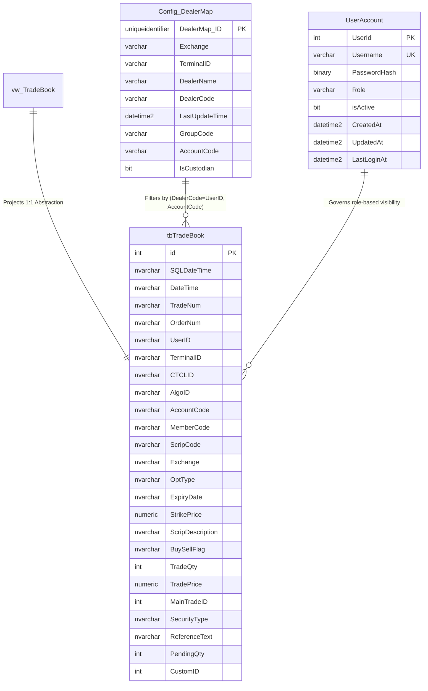
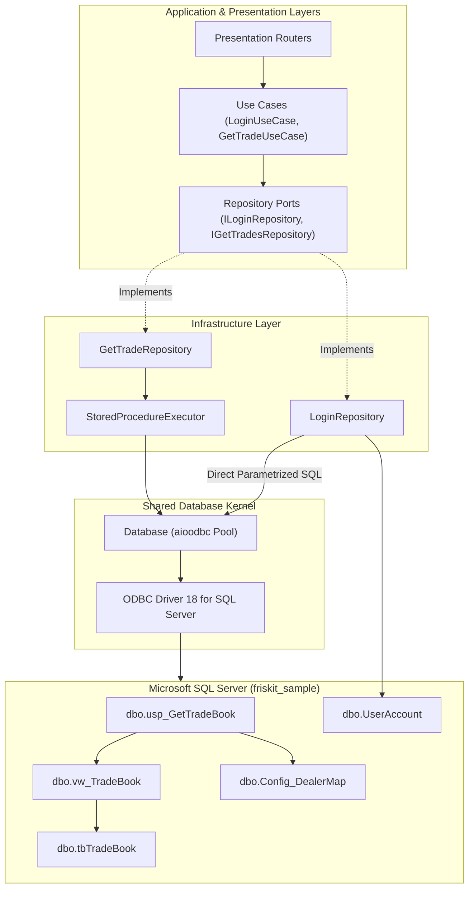

# Database Architecture & Context

## 1. Overview & Context

The **Ingestion Engine & TradeBook Platform** relies on **Microsoft SQL Server** as its primary relational data store (target database: `friskit_sample`). The database functions as the foundational backbone for high-throughput trade record persistence, simulated market ingestion, multi-tenant organizational mapping, and role-governed keyset-paginated queries.

### Core Objectives of the Database Layer
1. **High-Throughput Trade Storage**: Ingesting simulated trades continuously into [`dbo.tbTradeBook`](file:///d:/ingestion_engine/sql/Tables_DDL_queries.sql#L5-L34) with monotonically increasing IDs and timestamps.
2. **Enterprise Multi-Tenant Segregation**: Managing complex organizational hierarchies (Exchanges, Terminals, Brokers, Groups, and Dealers) via [`dbo.Config_DealerMap`](file:///d:/ingestion_engine/sql/Tables_DDL_queries.sql#L39-L66).
3. **Cryptographically Secure User State**: Storing salted and SHA-512 hashed user credentials, assigned RBAC roles, and login audit trails in [`dbo.UserAccount`](file:///d:/ingestion_engine/sql/Tables_DDL_queries.sql#L72-L84).
4. **Sub-Millisecond Read Queries via Stored Procedures**: Delegating query execution, keyset seek logic, and dual-result-set pagination to [`dbo.usp_GetTradeBook`](file:///d:/ingestion_engine/sql/SP_Query.sql#L4-L174) over the abstraction view [`dbo.vw_TradeBook`](file:///d:/ingestion_engine/sql/SP_Query.sql#L65).

---

## 2. Clean Architecture & Database Integration

The application follows strict **Clean Architecture (Ports & Adapters)** and **Read-Optimized CQRS** principles. The database layer is integrated across three architectural boundaries:

### 2.1 Asynchronous Connection Pooling ([`Database`](file:///d:/ingestion_engine/src/shared/database/connection.py))
* Implemented using **`aioodbc`** on top of `ODBC Driver 18 for SQL Server`.
* **Pool Configurations**:
  - `minsize`: 5 connections pre-warmed on application boot.
  - `maxsize`: 20 connections max concurrency.
  - `autocommit`: `True` for high-throughput single-statement and SP operations without explicit transaction overhead.
* **Connection Lifecycle**:
  - Acquired via `async with db.acquire_cursor() as cursor:`.
  - Guarantees immediate connection and cursor release back to the pool upon block termination, even when exceptions are raised.

### 2.2 Stored Procedure Execution Gateway ([`StoredProcedureExecutor`](file:///d:/ingestion_engine/src/shared/database/sp_executor.py))
* Asynchronously issues parametrized stored procedure calls (`EXEC <procedure_name> @p1 = ?, @p2 = ?`).
* Supports multi-result-set streaming via `cursor.nextset()`.
* Maps column names dynamically using `cursor.description`.
* Emits high-precision timing measurements (`execute_elapsed`, `fetch_elapsed`) for SQL profiling.

### 2.3 Read-Optimized CQRS & Direct DTO Projection
* **No ORM Overhead**: The query path deliberately avoids heavyweight ORM entity hydration (e.g., SQLAlchemy ORM models).
* **Direct DTO Projection**: Database result rows stream straight from the driver dictionaries into `TradeBookPageOutDto.from_db()` in [`src/features/Tradebook/Application/DTO/Outputs/TradeBookPageOutDto.py`](file:///d:/ingestion_engine/src/features/Tradebook/Application/DTO/Outputs/TradeBookPageOutDto.py#L54-L62), yielding benchmarked processing latencies of **~105–125 ms** for 2,000+ rows.

---

## 3. Database Components Directory

| Component | Path | Description |
| :--- | :--- | :--- |
| **Data Models Overview** | [`Datamodels/data_models_overview.md`](file:///d:/ingestion_engine/docs/Database/Datamodels/data_models_overview.md) | Relational design, entity mappings, and DTO contracts. |
| **`dbo.tbTradeBook`** | [`Datamodels/tbTradeBook.md`](file:///d:/ingestion_engine/docs/Database/Datamodels/tbTradeBook.md) | Trade book ledger table schema, fields, and indices. |
| **`dbo.Config_DealerMap`** | [`Datamodels/Config_DealerMap.md`](file:///d:/ingestion_engine/docs/Database/Datamodels/Config_DealerMap.md) | Dealer mapping, terminal IDs, account codes, and groups. |
| **`dbo.UserAccount`** | [`Datamodels/UserAccount.md`](file:///d:/ingestion_engine/docs/Database/Datamodels/UserAccount.md) | Authentication, SHA-512 hashes, RBAC roles, and audit timestamps. |
| **Stored Procedures** | [`Stored Procedures/usp_GetTradeBook.md`](file:///d:/ingestion_engine/docs/Database/Stored%20Procedures/usp_GetTradeBook.md) | Keyset pagination, dual result sets, and RBAC predicates. |
| **Views** | [`Views/vw_TradeBook.md`](file:///d:/ingestion_engine/docs/Database/Views/vw_TradeBook.md) | Data abstraction view, query surface, and design notes. |

---

## 4. Multi-Tier RBAC in Database Design

Access control in the database is designed with defense-in-depth:
1. **Tier 4 - `ADMIN`**: Firm-wide visibility. Can query any broker account, dealer ID, or group code.
2. **Tier 3 - `GROUP`**: Restricted to dealers and accounts mapped under their assigned `GroupCode` in `dbo.Config_DealerMap`.
3. **Tier 2 - `BROKER`**: Strictly bounded to trades matching their clearing `AccountCode`.
4. **Tier 1 - `DEALER`**: Strictly bounded to trades matching their personal `UserID`.

> [!IMPORTANT]
> The database stored procedure [`dbo.usp_GetTradeBook`](file:///d:/ingestion_engine/sql/SP_Query.sql#L68-L79) independently enforces these predicates in SQL. Even if the application layer were bypassed, unauthorized direct calls return 0 rows.
