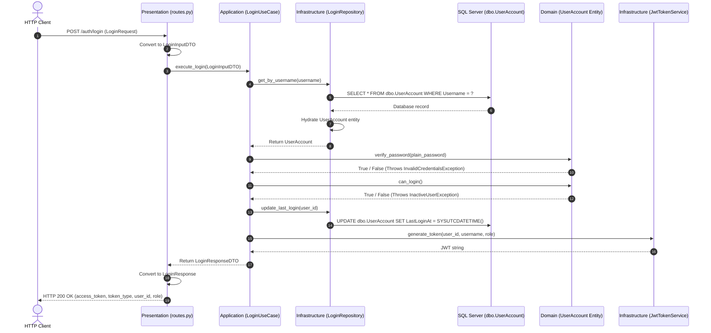
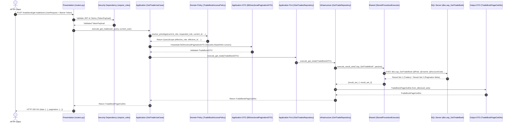

# System Architecture & Technical Specification

## 1. Executive Overview

The **Ingestion Engine & TradeBook Platform** is an enterprise-grade financial trade processing, simulated ingestion, and query system built with **FastAPI**, **Python 3.13**, **aioodbc**, and **Microsoft SQL Server**.

The project is structured according to **Clean Architecture** (Ports & Adapters / Hexagonal Architecture) combined with **Feature-Driven Modularization** and **Read-Optimized CQRS** principles:
* **Write & Command Workflows** (Authentication, Seed Ingestion) execute through rich **Domain Entities** that encapsulate state mutations and business invariants.
* **Heavy Read & Query Workflows** (TradeBook browsing, 2,000+ row pages) bypass artificial entity hydration, projecting directly from database rowsets into specialized **Output DTOs** via factory methods. This eliminates redundant object allocation overhead while strictly honoring architectural boundaries.
* **Domain Security Policies** (`TradeBookAccessPolicy`) enforce strict enterprise **Role-Based Access Control (RBAC)** independent of HTTP transport or database drivers.

```mermaid

flowchart LR
    Client["API Client"]

    subgraph P["Presentation Layer"]
        direction TB
        Router["FastAPI Router"]
        Validation["Pydantic Validation"]
        Auth["Authentication / Authorization"]
        RequestMap["Request DTO Mapping"]
        ResponseMap["Response Serialization"]
        Errors["Exception Handlers"]

        Router --> Validation --> Auth --> RequestMap
    end

    subgraph A["Application Layer"]
        direction TB
        InputDTO["Application Input DTO"]
        UseCase["Use Case / Interactor"]
        OutputDTO["Application Output DTO"]
        Port["Repository Port / Interface"]

        InputDTO --> UseCase --> OutputDTO
        UseCase --> Port
    end

    subgraph D["Domain Layer"]
        direction TB
        Entity["Entities / Value Objects"]
        Policies["Business Policies"]
        Services["Domain Services"]
        Rules["Business Invariants"]

        Entity --> Policies --> Services --> Rules
    end

    subgraph I["Infrastructure Layer"]
        direction TB
        Repo["Repository Implementation"]
        Mapper["Database Result Mapping"]
        SPGateway["Stored Procedure Gateway"]

        Repo --> SPGateway
        Mapper --> Repo
    end

    subgraph S["Shared Database Infrastructure"]
        direction TB
        Pool["Connection Pool"]
        Executor["SP Executor"]
        DBErrors["Database Error Translation"]

        Pool --> Executor
    end

    subgraph DB["SQL Server"]
        direction TB
        SP["Stored Procedures"]
        Tables[("Tables / Views")]

        SP --> Tables
    end

    Client --> Router
    RequestMap --> InputDTO
    UseCase --> Entity
    Rules --> UseCase

    Port -. "implemented by" .-> Repo
    SPGateway --> Pool
    Executor --> SP
    Tables --> Executor

    Repo --> Port
    OutputDTO --> ResponseMap
    ResponseMap --> Router

    Validation -. "validation errors" .-> Errors
    UseCase -. "application errors" .-> Errors
    Executor -. "database errors" .-> DBErrors
    DBErrors -. "translated exception" .-> Errors
    Errors -. "error response" .-> Client

    classDef presentation fill:#DCEAFE,stroke:#4779BD,color:#172B4D
    classDef application fill:#DDF5E5,stroke:#43865D,color:#173C29
    classDef domain fill:#FBE8CF,stroke:#B47A31,color:#55350E
    classDef infrastructure fill:#EDE3FC,stroke:#8763B0,color:#35204F
    classDef shared fill:#FCE4EC,stroke:#B45D78,color:#4A1E2C
    classDef database fill:#E5E7EB,stroke:#6B7280,color:#111827

    class Router,Validation,Auth,RequestMap,ResponseMap,Errors presentation
    class InputDTO,UseCase,OutputDTO,Port application
    class Entity,Policies,Services,Rules domain
    class Repo,Mapper,SPGateway infrastructure
    class Pool,Executor,DBErrors shared
    class SP,Tables database

```


---

## 2. Core Architectural Principles

### 2.1 The Dependency Rule
Dependencies **strictly point inward**:
1. **Domain Layer** is the core. It has **zero dependencies** on external libraries, frameworks, or databases. Contains domain policies, business exceptions, and core entities.
2. **Application Layer** depends only on the Domain Layer. It defines abstract **Ports** (interfaces), Use Cases, and transport-agnostic DTOs.
3. **Infrastructure Layer** depends on Application Ports and Domain Entities, implementing concrete database access and third-party integrations.
4. **Presentation Layer** depends on Application Use Cases and Schemas, handling HTTP transport and response formatting.

### 2.2 Ports & Adapters (Dependency Inversion)
Application Use Cases never instantiate or depend on concrete infrastructure classes (like database connections or token libraries). Instead:
* Application defines abstract contracts (**Ports**): e.g. `ILoginRepository`, `ITokenService`, `IGetTradesRepository`.
* Infrastructure provides concrete implementations (**Adapters**): e.g. `LoginRepository`, `JwtTokenService`, `GetTradeRepository`.
* Presentation wires dependencies together using FastAPI's dependency injection (`Depends`).

### 2.3 Read-Optimized CQRS & Direct DTO Projection
In high-throughput financial trading systems, instantiating thousands of ephemeral Domain Entity objects solely to discard them during JSON serialization introduces severe garbage collection pressure and CPU overhead:
* **Transaction/Write Paths**: Require full Domain Entity lifecycle (`UserAccount.verify_password()`, `UserAccount.can_login()`).
* **Query/Heavy Read Paths**: Follow a **Direct Projection Read Model**. `GetTradeRepository` executes the stored procedure and passes raw result sets directly into `TradeBookPageOutDto.from_db()`.
* **Zero Entity Leakage**: Neither Domain Entities nor database tuples ever leak into the HTTP response.

### 2.4 Transport vs. Domain Boundary Decoupling
* **Cursor Encoding/Decoding**: Keyset pagination cursors are Base64-encoded strings over HTTP for opacity and URL-safety. Decoding occurs cleanly in `BiDirectionalPaginationDTO.__post_init__` at the Application boundary, keeping the Domain Layer pure and free from transport concerns.
* **Thin Routers**: Routers contain **zero business logic**. A router's sole responsibility is accepting the HTTP request, extracting JWT claims via dependencies, and delegating to the Use Case.

---

## 3. Directory Structure

```text
ingestion_engine/
├── architecture.md                     # System architecture specification
├── pyproject.toml                      # Package dependencies & configuration
├── .env                                # Environment configurations (DATABASE_URI, secrets)
├── sql/
│   └── SP_Query.sql                    # Optimized Stored Procedure + 9-Part Privilege Test Suite
├── scripts/
│   └── monitor_api_tradebook.py        # Real-time CLI verification & monitoring script
├── tests/
│   ├── test_auth_flow.py               # Authentication integration & unit tests
│   ├── test_connection.py              # Database pool connectivity tests
│   ├── test_cursor_pagination.py       # Keyset pagination & bidirectional navigation tests
│   ├── test_ingestion_api.py           # Ingestion API endpoints tests
│   ├── test_ingestion_engine.py        # Background trade generator unit tests
│   └── test_tradebook_rbac.py          # RBAC privilege & security isolation tests
└── src/
    ├── app.py                          # FastAPI application factory & lifespan context
    ├── shared/                         # Cross-cutting infrastructure kernel
    │   ├── config/
    │   │   └── settings.py             # Pydantic BaseSettings environment loader
    │   ├── database/
    │   │   ├── connection.py           # aioodbc Connection Pool lifecycle manager
    │   │   └── sp_executor.py          # Asynchronous multi-result-set SP runner
    │   └── security/
    │       ├── jwt.py                  # HMAC-SHA256 JWT encoding, decoding & TokenPayload
    │       └── dependencies.py         # FastAPI security dependencies (require_roles)
    ├── ingestion_engine/               # Core background trade simulator
    │   ├── config.py                   # Seed dealers, instruments & exchange configs
    │   └── engine.py                   # TradeIngestionEngine async background worker
    └── features/                       # Modular Clean Architecture Features
        ├── Auth/                       # Authentication & Authorization Feature
        │   ├── Domain/
        │   │   ├── entities/user_account.py
        │   │   └── exceptions.py
        │   ├── Application/
        │   │   ├── ports/
        │   │   │   ├── LoginRepository.py
        │   │   │   └── TokenService.py
        │   │   ├── DTO/
        │   │   │   ├── Input/LoginDTO.py
        │   │   │   └── Output/LoginResponseDTO.py
        │   │   └── use_cases/LoginUseCase.py
        │   ├── Infrastructure/
        │   │   ├── repositories/LoginRepository.py
        │   │   └── services/JwtTokenService.py
        │   └── Presentation/
        │       ├── schemas/LoginData.py
        │       └── routes.py
        ├── Tradebook/                  # Trade Query & Keyset Pagination Feature
        │   ├── Domain/
        │   │   ├── policies/
        │   │   │   └── TradeBookAccessPolicy.py # Centralized RBAC privilege rules
        │   │   ├── entities/
        │   │   │   └── Trade.py
        │   │   ├── exceptions.py       # PrivilegeEscalation, UnauthorizedUserAccess
        │   │   └── value_objects/
        │   ├── Application/
        │   │   ├── ports/
        │   │   │   └── GetTradesRepository.py   # IGetTradesRepository port
        │   │   ├── DTO/
        │   │   │   ├── Inputs/
        │   │   │   │   ├── UserdataDTO.py
        │   │   │   │   ├── BiDirectionalPaginationDTO.py # Decodes Base64/int cursors
        │   │   │   │   └── TradeBookDTO.py
        │   │   │   └── Outputs/
        │   │   │       ├── TradeBookPageOutDto.py    # Direct projection factory
        │   │   │       └── TradeBookOutDto.py        # Re-export & item schema
        │   │   └── use_cases/
        │   │       └── get_trade.py                  # GetTradeUseCase orchestrator
        │   ├── Infrastructure/
        │   │   └── repositories/
        │   │       └── get_trade.py                  # GetTradeRepository adapter
        │   └── Presentation/
        │       ├── schemas/
        │       │   └── UserRequest.py                # HTTP Pydantic request schema
        │       └── routers.py                        # Thin APIRouter delegator
        └── Ingestion/                  # Ingestion Control API Feature
            └── Presentation/
                └── routes.py           # /ingestion/start, /stop, /status, /generate-sample
```

---

## 4. Feature Deep Dives

### 4.1 Authentication Feature (`src/features/Auth`)

Handles user authentication against `dbo.UserAccount`, password verification, and scoped JWT issuance.

#### Domain Logic & Security
* Passwords are stored in the database as **64-byte binary SHA-512 hashes**.
* Verification uses `hmac.compare_digest` in `UserAccount.verify_password()` to prevent timing attacks.
* User status is checked via `UserAccount.can_login()`.

#### Flow of Control


---

### 4.2 TradeBook Feature (`src/features/Tradebook`)

Provides RBAC-governed tradebook browsing with **keyset bidirectional pagination** and high-throughput SQL Server streaming.

#### Multi-Tier RBAC Privilege Hierarchy
Access control follows a strict 4-tier hierarchy:

```text
[ ADMIN (Tier 4) ]    -> Full unrestricted firm-wide visibility; can filter by any Account, Dealer, or Group
       │
[ GROUP (Tier 3) ]    -> Bounded strictly by Config_DealerMap; sees mapped accounts & dealers under GroupCode
       │
[ BROKER (Tier 2) ]   -> Bounded strictly to AccountCode (e.g. '90068'); sees all dealers under their account
       │
[ DEALER (Tier 1) ]   -> Strictly bounded to UserID (e.g. 'SUP'); zero visibility into other dealers or higher levels
```

| Role | Hierarchy Level | Query Bounds & Invariants | Security Safeguards |
| :--- | :---: | :--- | :--- |
| **`ADMIN`** | **Tier 4** | Global firm-wide access. Can query without filters, or optionally impersonate/filter by any `account_code`, `user_id`, or `group_code`. | Full audit capabilities. |
| **`GROUP`** | **Tier 3** | Strictly bounded to `dbo.Config_DealerMap` where `GroupCode = current_user.group_code`. Sees all trades for mapped dealers under mapped accounts. | Cannot access accounts/dealers outside assigned group mapping. |
| **`BROKER`** | **Tier 2** | Strictly bounded to `tbTradeBook.AccountCode = current_user.account_code`. Sees all trades executed by dealers under their clearing account. | Cannot view trades of another broker account. Cannot request Group scope (`group_code` stripped). |
| **`DEALER`** | **Tier 1** | Strictly restricted to trades where `UserID = current_user.sub`. | Cannot view trades of other dealers (`requested_id != current_id` raises 403). Zero broker/group level reporting scope. |

#### Dual-Layer Security Defense
1. **Application/Domain Defense (`TradeBookAccessPolicy`)**:
   - Validates that non-admins cannot escalate roles (`requested_role != current_role`).
   - Prevents dealers from snooping on other dealers (`requested_id != current_id`).
   - Computes an immutable `QueryScope(effective_role, effective_user_id, account_code, group_code)`.
2. **Database Engine Defense (`dbo.usp_GetTradeBook`)**:
   - The SQL `WHERE` clause independently enforces non-null checks and mathematical partitioning:
     ```sql
     (@Role = 'ADMIN' AND (@AccountCode IS NULL OR TB.AccountCode = @AccountCode) ...)
     OR (@Role = 'BROKER' AND @AccountCode IS NOT NULL AND TB.AccountCode = @AccountCode ...)
     OR (@Role = 'DEALER' AND @UserId IS NOT NULL AND TB.UserID = @UserId)
     OR (@Role = 'GROUP' AND @GroupCode IS NOT NULL AND EXISTS (...))
     ```
   - If a caller calls the SP directly with `@Role = 'BROKER', @AccountCode = NULL`, the query returns exactly **0 rows**.

#### Keyset Bidirectional Pagination & Temp Table Optimization
To avoid expensive `OFFSET / FETCH` scans and CTE worktable proliferation:
* **Forward Seek (NEXT Page)**: Seeks older trades: `TB.id < @EndCursor ORDER BY TB.id DESC`.
* **Backward Seek (PREV Page)**: Seeks newer trades: `TB.id > @StartCursor ORDER BY TB.id ASC`.
* **Temp Table `#FetchedRows` + `#PageWindow`**: Materializes `@Limit + 1` rows into `#FetchedRows`, completely eliminating the Worktable 2001-scan overhead of per-row CTE scalar subqueries.
* **Dual Result Sets**:
  - **Result Set 1**: Page data window (`TOP (@Limit)` rows ordered by `id DESC`).
  - **Result Set 2**: Pagination metadata single row: `StartCursor`, `EndCursor`, `HasPrev`, `HasNext`.

#### Response Structure
```json
{
  "data": [
    {
      "trade_id": 6606,
      "member_code": "MEM001",
      "symbol": "NIFTY",
      "quantity": 25,
      "price": "207.350000",
      "trade_time": "2026-10-13 15:03:53.187"
    }
  ],
  "pagination": {
    "cursor_start": 6606,
    "cursor_end": 6598,
    "has_prev": false,
    "has_next": true
  }
}
```

#### Flow of Control


---

### 4.3 Ingestion Feature (`src/features/Ingestion` & `src/ingestion_engine`)

A background trade generator producing realistic trade activity for stress testing, demonstration, and throughput validation.

* **Seed Identity Enforcement**: Trades are strictly assigned to valid dealers, terminals, account codes, and group mappings defined in `dbo.Config_DealerMap`.
* **State Synchronization**: On startup, `TradeIngestionEngine` inspects `MAX(MainTradeID)` in `tbTradeBook` to ensure strictly monotonically increasing IDs.
* **Controlled Lifecycle**: Managed in FastAPI's `lifespan` context or controlled dynamically via HTTP endpoints:
  - `POST /ingestion/start`: Launches background worker loop with configurable batch size and interval.
  - `POST /ingestion/stop`: Cancels and gracefully awaits task shutdown.
  - `GET /ingestion/status`: Reports runtime metrics (trades/sec, total inserted, last trade details).
  - `POST /ingestion/generate-sample`: Synchronously inserts $N$ trades and returns them in the API format.

---

## 5. Shared Infrastructure & Foundation

### 5.1 Asynchronous Database Connection Pooling (`Database`)
* Located at [`src/shared/database/connection.py`](file:///d:/ingestion_engine/src/shared/database/connection.py).
* Wraps **`aioodbc`** connected to Microsoft SQL Server via `ODBC Driver 18 for SQL Server`.
* Pool configurations: `minsize=5`, `maxsize=20`, `autocommit=True`.
* Exposes context managers:
  - `acquire_connection()`: Safely checks out and returns connections.
  - `acquire_cursor()`: Context manager acquiring both connection and cursor, guaranteeing cleanup upon block exit.

### 5.2 Multi-Result-Set Stored Procedure Executor (`StoredProcedureExecutor`)
* Located at [`src/shared/database/sp_executor.py`](file:///d:/ingestion_engine/src/shared/database/sp_executor.py).
* Automatically parameterizes execution statements: `EXEC procedure_name @param1 = ?, @param2 = ?`.
* Exposes two core execution methods:
  - `execute(procedure_name, params)`: Fetches a single result set as a list of column-mapped dictionaries.
  - `execute_result_sets(procedure_name, params)`: Consumes multiple result sets via `cursor.nextset()`, returning `list[list[dict[str, Any]]]`. Essential for stored procedures that return row records alongside aggregated pagination metadata.

### 5.3 JWT Security & RBAC Dependencies
* [`src/shared/security/jwt.py`](file:///d:/ingestion_engine/src/shared/security/jwt.py): Issues and verifies HMAC-SHA256 signed JWT tokens containing claims: `sub`, `user_id`, `role`, and expiration timestamp `exp`.
* [`src/shared/security/dependencies.py`](file:///d:/ingestion_engine/src/shared/security/dependencies.py): Provides reusable FastAPI dependencies:
  - `get_current_user`: Validates `Authorization: Bearer <token>` and extracts user claims.
  - `require_roles(["ADMIN", "BROKER", "DEALER", "GROUP"])`: Enforces endpoint-level RBAC role authorization.

---

## 6. Performance & Latency Profile

Empirical benchmarks conducted on local SQL Server with 2,000 returned records:

| Layer | Benchmark | Details |
| :--- | :--- | :--- |
| **SQL Engine Execution** | **~80 – 170 ms** | Direct stored procedure execution via `aioodbc` connection pool. |
| **Repository & DTO Mapping** | **~105 – 125 ms** | SP execution + direct projection into `TradeBookPageOutDto` (zero intermediate entity allocation). |
| **End-to-End HTTP API** | **~145 – 220 ms** | Full roundtrip: JWT authentication + RBAC validation + DB execution + Pydantic serialization of 409 KB payload. |

### Note on SSMS Client Rendering Discrepancy
When benchmarking `dbo.usp_GetTradeBook` in SQL Server Management Studio (SSMS), `STATISTICS TIME` may report elapsed times of **6+ seconds** despite CPU time being only **78 ms**. This is caused by SSMS GUI client rendering (`ASYNC_NETWORK_IO` wait state while drawing 56,000 cells in the Results Grid). In production and via the Python ODBC driver, network streaming completes in under **180 ms**.

---

## 7. Testing & Verification Strategy

The repository contains an automated test suite executed with Python's standard `unittest` framework alongside a comprehensive database-level T-SQL test harness:

### 7.1 Python Automated Unit & Integration Tests
```bash
python -m unittest discover tests
```

* **`test_auth_flow.py`**: Verifies login success, bad password rejection, inactive user blocking, and JWT verification.
* **`test_tradebook_rbac.py`**: Validates role isolation (dealers cannot view other dealers; brokers cannot view other accounts; dealers/brokers cannot escalate to admin).
* **`test_cursor_pagination.py`**: Validates forward seek, backward seek, Base64 decoding in DTOs, and lookahead flags.
* **`test_ingestion_engine.py`**: Tests generator step executions, seed mappings, and counter synchronization.
* **`test_ingestion_api.py`**: Verifies ingestion lifecycle HTTP endpoints and authorization guards.

### 7.2 Database Privilege & RBAC Verification Suite (`sql/SP_Query.sql`)
The SQL file contains a complete 9-part test suite designed for execution in SSMS:
1. **Admin Tests**: Unrestricted audit, filtering by dealer, broker account, or group.
2. **Broker Tests**: AccountCode segregation (Account 90068 vs 90069), inspecting specific dealers under an account.
3. **Dealer Tests**: Terminal segregation (Dealer SUP vs D001), asserting that dealers without UserID return 0 rows.
4. **Group Tests**: Branch mapping via `dbo.Config_DealerMap` (HO vs GRP2 vs non-existent groups).
5. **Combined Keyset Pagination Tests**: Forward and backward navigation with cursors.
6. **Direct Privilege Scope & Hierarchy Audits**: Raw SELECT queries confirming what brokers, dealers, and groups each role is mathematically privileged to inspect.
7. **Negative Testing & Boundary Breach Assertions**: Anti-snooping checks (Dealer SUP attempting to access D001 returns 0 rows; Broker 90068 attempting to access 90069 returns 0 rows; Group GRP2 attempting to access SUP returns 0 rows).
8. **Mathematical Reconciliation**: Verifies that partitioned role counts sum exactly to the firm total with zero data loss and zero data leakage.
9. **Automated Self-Checking Harness**: T-SQL script evaluating boundary assertions and printing formatted `[PASS]` / `[FAIL]` indicators.
