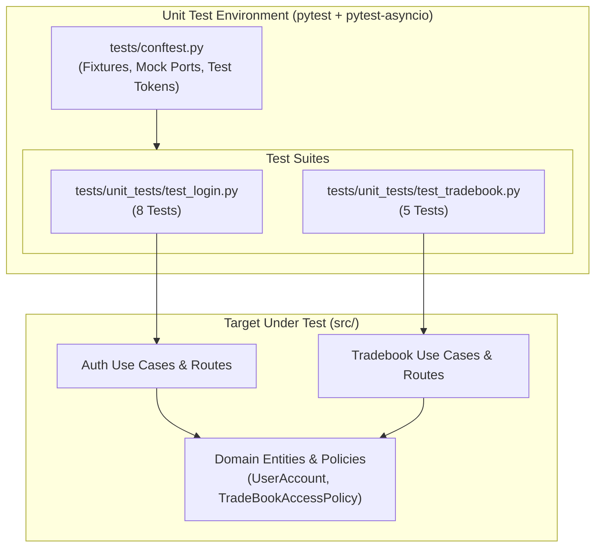
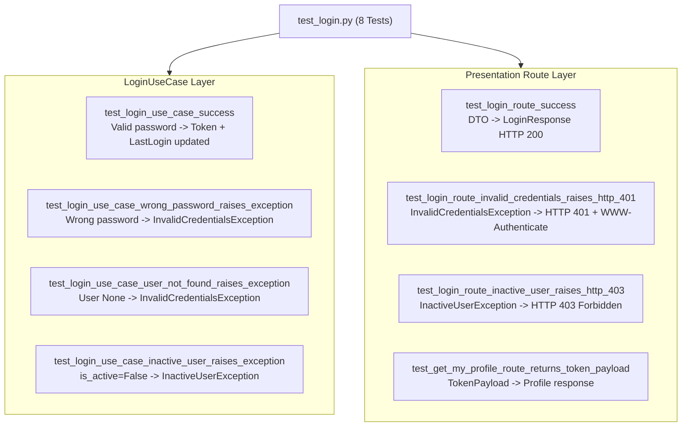
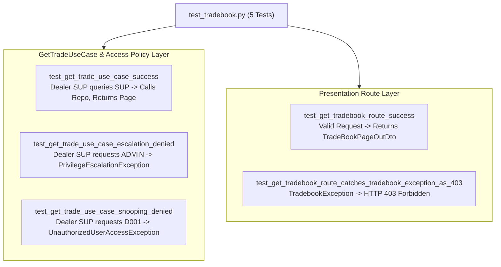

# Unit Testing Architecture & Test Suite Guide

## 1. Overview & Testing Philosophy

The test suite in [`tests/`](file:///d:/ingestion_engine/tests/) provides comprehensive automated verification of domain logic, application use cases, and presentation routes.

### Clean Architecture Isolation
The unit test suite follows **pure architectural isolation**:
* **Zero Database Dependency**: All unit tests run entirely in-memory using Python's standard `unittest.mock.AsyncMock` to stub out external ports (`ILoginRepository`, `IGetTradesRepository`, `ITokenService`).
* **Deterministic Execution**: Tests execute without requiring Microsoft SQL Server, ODBC drivers, or network connections.
* **Ultra-Fast Feedback**: The entire 13-test unit suite executes in **< 1.0 second**.



---

## 2. Test Fixtures Architecture ([`tests/conftest.py`](file:///d:/ingestion_engine/tests/conftest.py))

`conftest.py` defines reusable fixtures across two functional categories: **Mock Ports/Services** and **Security Tokens/Entities**.

### 2.1 Mock Ports & Use Cases

| Fixture | Target Type | Behavior / Return Value |
| :--- | :--- | :--- |
| **`mock_login_repo`** | `AsyncMock(spec=ILoginRepository)` | Mocks repository port methods `get_by_username()` and `update_last_login()`. |
| **`mock_token_service`**| `AsyncMock(spec=ITokenService)` | Mocks JWT generation service `generate_token()`. |
| **`mock_login_use_case`**| `AsyncMock(spec=LoginUseCase)` | Stubs use case execution for direct route testing. |
| **`mock_trade_repo`** | `AsyncMock(spec=IGetTradesRepository)` | Pre-configured to return a dummy `TradeBookPageOutDto` with 1 trade record (ID 5609) and pagination metadata. |
| **`mock_trade_use_case`**| `AsyncMock(spec=GetTradeUseCase)` | Stubs `execute_get_trade()` for testing presentation routers. |

### 2.2 Security Tokens & Domain Entities

| Fixture | Scope | Description |
| :--- | :--- | :--- |
| **`admin_token`** | Function | Real HMAC-SHA256 JWT issued for user `admin` with `role="ADMIN"`. |
| **`dealer_token`**| Function | Real HMAC-SHA256 JWT issued for dealer `SUP` with `role="DEALER"`. |
| **`broker_token`**| Function | Real HMAC-SHA256 JWT issued for broker `broker1` with `role="BROKER"`. |
| **`admin_headers`** | Function | HTTP headers containing `Authorization: Bearer <admin_token>`. |
| **`dealer_headers`**| Function | HTTP headers containing `Authorization: Bearer <dealer_token>`. |
| **`broker_headers`**| Function | HTTP headers containing `Authorization: Bearer <broker_token>`. |
| **`sample_user_account`** | Function | Pre-instantiated active [`UserAccount`](file:///d:/ingestion_engine/src/features/Auth/Domain/entities/user_account.py) entity with SHA-512 hash for password `"securePassword123!"`. |
| **`sample_inactive_user`**| Function | Pre-instantiated inactive [`UserAccount`](file:///d:/ingestion_engine/src/features/Auth/Domain/entities/user_account.py) entity (`is_active=False`) for rejection testing. |

---

## 3. Test Suites Breakdown

### 3.1 Authentication Unit Tests ([`tests/unit_tests/test_login.py`](file:///d:/ingestion_engine/tests/unit_tests/test_login.py))

Contains 8 tests covering Use Case logic, cryptographic hash matching, entity state verification, and presentation route responses:



#### Detailed Test Catalog: `test_login.py`

| Test Function | Layer Tested | Scenario & Assertions |
| :--- | :--- | :--- |
| **`test_login_use_case_success`** | Application (`LoginUseCase`) | Validates happy path: verifies password, asserts `update_last_login` called with UserID `1`, asserts `generate_token` called, and returns `access_token`. |
| **`test_login_use_case_wrong_password_raises_exception`** | Application (`LoginUseCase`) | Asserts `InvalidCredentialsException` when password does not match SHA-512 hash. Verifies `update_last_login` and `generate_token` are never called. |
| **`test_login_use_case_user_not_found_raises_exception`** | Application (`LoginUseCase`) | Asserts `InvalidCredentialsException` when repository returns `None`. |
| **`test_login_use_case_inactive_user_raises_exception`** | Application (`LoginUseCase`) | Asserts `InactiveUserException` when `user.can_login()` returns `False`. |
| **`test_login_route_success`** | Presentation (`routes.py`) | Tests `/auth/login` route serialization into `LoginResponse` DTO with `token_type="bearer"`. |
| **`test_login_route_invalid_credentials_raises_http_401`** | Presentation (`routes.py`) | Asserts conversion of `InvalidCredentialsException` into `HTTPException(status_code=401)` with `WWW-Authenticate: Bearer` header. |
| **`test_login_route_inactive_user_raises_http_403`** | Presentation (`routes.py`) | Asserts conversion of `InactiveUserException` into `HTTPException(status_code=403)`. |
| **`test_get_my_profile_route_returns_token_payload`** | Presentation (`routes.py`) | Asserts `/auth/me` returns current authenticated claims (`sub`, `user_id`, `role`). |

---

### 3.2 TradeBook Unit Tests ([`tests/unit_tests/test_tradebook.py`](file:///d:/ingestion_engine/tests/unit_tests/test_tradebook.py))

Contains 5 tests validating RBAC security policy resolution, anti-snooping safeguards, and query delegation:



#### Detailed Test Catalog: `test_tradebook.py`

| Test Function | Layer Tested | Scenario & Assertions |
| :--- | :--- | :--- |
| **`test_get_trade_use_case_success`** | Application (`GetTradeUseCase`) | Authenticated dealer `SUP` queries own trades. Asserts policy resolution succeeds, repository is called once, and `TradeBookPageOutDto` is returned. |
| **`test_get_trade_use_case_escalation_denied`** | Application (`GetTradeUseCase`) | Dealer attempts privilege escalation (`requested_role="ADMIN"`). Asserts `PrivilegeEscalationException` is raised and repository is **never called**. |
| **`test_get_trade_use_case_snooping_denied`** | Application (`GetTradeUseCase`) | Dealer `SUP` attempts to inspect trades of dealer `D001`. Asserts `UnauthorizedUserAccessException` is raised and repository is **never called**. |
| **`test_get_tradebook_route_success`** | Presentation (`routers.py`) | Verifies `/tradebook/get-tradebook` returns serialized page output with pagination metadata. |
| **`test_get_tradebook_route_catches_tradebook_exception_as_403`** | Presentation (`routers.py`) | Asserts that domain `TradebookException` raised during use case execution is converted by the route handler into `HTTPException(status_code=403)`. |

---

## 4. Running the Unit Tests

The test suite uses **`pytest`** configured with **`pytest-asyncio`** in strict mode.

### 4.1 Running All Tests via `uv`
To ensure the project root is on `PYTHONPATH`, execute pytest through `python -m`:

```bash
uv run python -m pytest
```

### 4.2 Running Specific Test Files
```bash
# Run only authentication tests
uv run python -m pytest tests/unit_tests/test_login.py

# Run only tradebook RBAC tests
uv run python -m pytest tests/unit_tests/test_tradebook.py
```

### 4.3 Filtering Tests by Keyword
```bash
# Run tests matching 'escalation'
uv run python -m pytest -k "escalation"

# Run tests matching 'route'
uv run python -m pytest -k "route" -v
```

### 4.4 Expected Test Suite Output
```text
============================= test session starts =============================
platform win32 -- Python 3.13.13, pytest-9.1.1, pluggy-1.6.0
rootdir: D:\ingestion_engine
configfile: pyproject.toml
plugins: anyio-4.15.1, asyncio-1.4.0
asyncio: mode=Mode.STRICT
collected 13 items

tests\unit_tests\test_login.py ........                                  [ 61%]
tests\unit_tests\test_tradebook.py .....                                 [100%]

======================== 13 passed in 0.65s ========================
```

---

## 5. Unit Testing Patterns & Conventions

### 5.1 Async Test Marking
All async test coroutines must be decorated with `@pytest.mark.asyncio`:
```python
@pytest.mark.asyncio
async def test_example(mock_login_repo: AsyncMock):
    ...
```

### 5.2 Strict Mock Assertion Verification
Tests verify both state outcomes and architectural boundary interactions:
```python
# Assert method was called with precise arguments
mock_login_repo.get_by_username.assert_called_once_with("admin")

# Assert forbidden methods were never invoked (guarding against unwanted writes)
mock_login_repo.update_last_login.assert_not_called()
```
