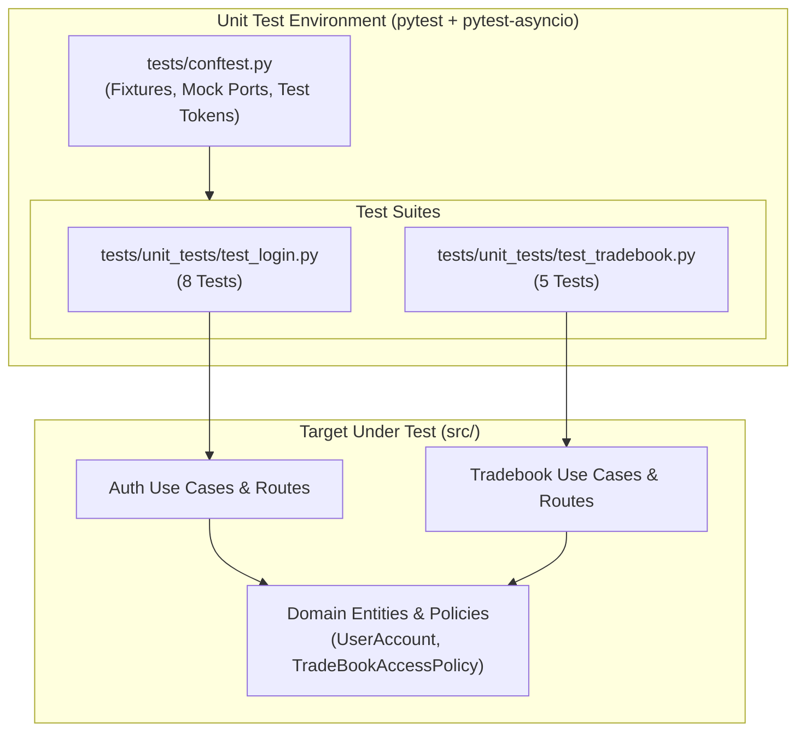
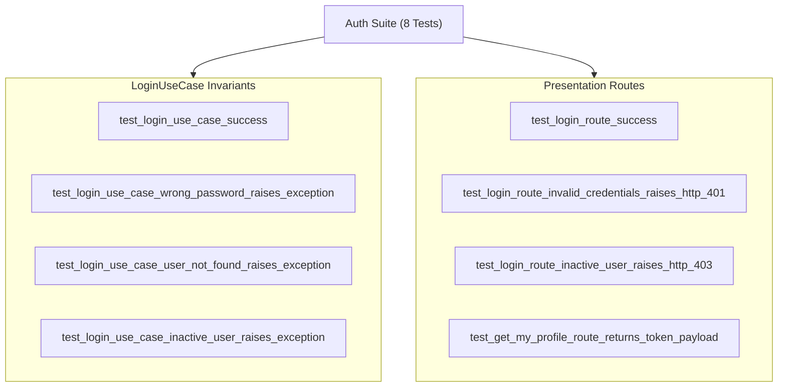
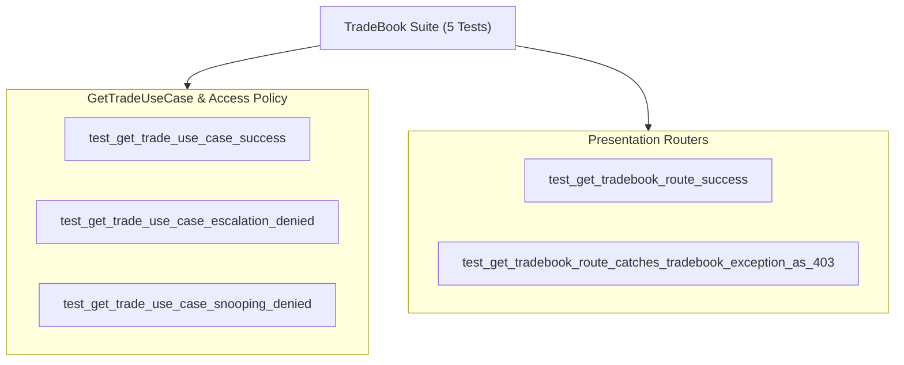

# Unit Testing Architecture & Test Catalog

## 1. Unit Testing Philosophy

The unit test suite located in [`tests/unit_tests/`](file:///d:/ingestion_engine/tests/unit_tests/) provides isolated, automated verification of:
1. **Domain Business Invariants** (Password hashing, active account checks, RBAC policy escalation/snooping rules).
2. **Application Use Cases** (Data transfer orchestration, repository calls, token generation).
3. **Presentation HTTP Routers** (DTO-to-schema mapping, HTTP status translation, exception handling).

### Clean Architecture Isolation
The unit test suite follows **pure architectural isolation**:
* **Zero Database Dependency**: All unit tests run in-memory using `unittest.mock.AsyncMock` to stub out external ports (`ILoginRepository`, `IGetTradesRepository`, `ITokenService`).
* **Deterministic Execution**: Tests execute without requiring Microsoft SQL Server, ODBC drivers, network connectivity, or file system modifications.
* **Sub-Second Feedback**: The entire suite runs in **< 1.0 second**.

---

## 2. Test Fixtures Catalog ([`tests/conftest.py`](file:///d:/ingestion_engine/tests/conftest.py))

`conftest.py` is the centralized fixture harness for all unit tests.

### 2.1 Mock Ports & Use Cases

| Fixture | Target Interface | Mock Configuration |
| :--- | :--- | :--- |
| **`mock_login_repo`** | [`ILoginRepository`](file:///d:/ingestion_engine/src/features/Auth/Application/ports/LoginRepository.py) | `AsyncMock(spec=ILoginRepository)`. Used to stub `get_by_username()` and `update_last_login()`. |
| **`mock_token_service`**| [`ITokenService`](file:///d:/ingestion_engine/src/features/Auth/Application/ports/TokenService.py) | `AsyncMock(spec=ITokenService)`. Used to stub `generate_token()`. |
| **`mock_login_use_case`**| [`LoginUseCase`](file:///d:/ingestion_engine/src/features/Auth/Application/use_cases/LoginUseCase.py) | `AsyncMock(spec=LoginUseCase)`. Used to test presentation routes independently. |
| **`mock_trade_repo`** | [`IGetTradesRepository`](file:///d:/ingestion_engine/src/features/Tradebook/Application/ports/GetTradesRepository.py) | `AsyncMock(spec=IGetTradesRepository)`. Pre-configured to return a dummy `TradeBookPageOutDto` (Trade ID 5609, symbol BANKNIFTY) and pagination metadata. |
| **`mock_trade_use_case`**| [`GetTradeUseCase`](file:///d:/ingestion_engine/src/features/Tradebook/Application/use_cases/get_trade.py) | `AsyncMock(spec=GetTradeUseCase)`. Used to test `/tradebook/get-tradebook` endpoint handlers. |

### 2.2 Security Tokens & Headers

| Fixture | Claims (`sub`, `user_id`, `role`) | Intended Use |
| :--- | :--- | :--- |
| **`admin_token`** | `sub="admin"`, `user_id=1`, `role="ADMIN"` | Admin role bypass and audit queries. |
| **`dealer_token`**| `sub="SUP"`, `user_id=2`, `role="DEALER"` | Dealer terminal level verification. |
| **`broker_token`**| `sub="broker1"`, `user_id=4`, `role="BROKER"` | Broker account segregation tests. |
| **`admin_headers`** | `Authorization: Bearer <admin_token>` | Direct HTTP dependency injection testing. |
| **`dealer_headers`**| `Authorization: Bearer <dealer_token>` | Direct HTTP dependency injection testing. |
| **`broker_headers`**| `Authorization: Bearer <broker_token>` | Direct HTTP dependency injection testing. |

### 2.3 Domain Entity Fixtures

* **`sample_user_account`**:
  An active [`UserAccount`](file:///d:/ingestion_engine/src/features/Auth/Domain/entities/user_account.py) with `is_active=True`, role `'ADMIN'`, and password hash matching `'securePassword123!'` using SHA-512.
* **`sample_inactive_user`**:
  An inactive [`UserAccount`](file:///d:/ingestion_engine/src/features/Auth/Domain/entities/user_account.py) with `is_active=False` for testing access denial.

---

## 3. Test Suites Catalog

### 3.1 Authentication Tests ([`tests/unit_tests/test_login.py`](file:///d:/ingestion_engine/tests/unit_tests/test_login.py))

| Test Name | Layer | Scenario Tested | Key Invariants Asserted |
| :--- | :--- | :--- | :--- |
| **`test_login_use_case_success`** | Application | Valid username + password matching hash. | `access_token` returned; `mock_login_repo.update_last_login(1)` called once; `mock_token_service.generate_token()` called once. |
| **`test_login_use_case_wrong_password_raises_exception`** | Application | Incorrect password provided. | Raises [`InvalidCredentialsException`](file:///d:/ingestion_engine/src/features/Auth/Domain/exceptions.py); `update_last_login` and `generate_token` **never called**. |
| **`test_login_use_case_user_not_found_raises_exception`** | Application | User does not exist in repository (`None`). | Raises [`InvalidCredentialsException`](file:///d:/ingestion_engine/src/features/Auth/Domain/exceptions.py). |
| **`test_login_use_case_inactive_user_raises_exception`** | Application | Account has `is_active = False`. | Raises [`InactiveUserException`](file:///d:/ingestion_engine/src/features/Auth/Domain/exceptions.py). |
| **`test_login_route_success`** | Presentation | Route invocation with valid credentials. | Returns HTTP 200 with `LoginResponse` DTO containing token and user profile. |
| **`test_login_route_invalid_credentials_raises_http_401`** | Presentation | Route handles domain `InvalidCredentialsException`. | Converts to `HTTPException(401)` with `WWW-Authenticate: Bearer` header. |
| **`test_login_route_inactive_user_raises_http_403`** | Presentation | Route handles domain `InactiveUserException`. | Converts to `HTTPException(403)` with `"Account is inactive"`. |
| **`test_get_my_profile_route_returns_token_payload`** | Presentation | Invocation of `/auth/me` with valid token. | Returns current user identity (`sub`, `user_id`, `role`). |

---

### 3.2 TradeBook & RBAC Tests ([`tests/unit_tests/test_tradebook.py`](file:///d:/ingestion_engine/tests/unit_tests/test_tradebook.py))

| Test Name | Layer | Scenario Tested | Key Invariants Asserted |
| :--- | :--- | :--- | :--- |
| **`test_get_trade_use_case_success`** | Application | Authenticated dealer queries their own trades. | Resolves query scope; calls `mock_trade_repo.execute_get_trade()`; returns `TradeBookPageOutDto`. |
| **`test_get_trade_use_case_escalation_denied`** | Application | Dealer requests `ADMIN` role. | Policy raises [`PrivilegeEscalationException`](file:///d:/ingestion_engine/src/features/Tradebook/Domain/exceptions.py); repository **never called**. |
| **`test_get_trade_use_case_snooping_denied`** | Application | Dealer `SUP` requests trades for dealer `D001`. | Policy raises [`UnauthorizedUserAccessException`](file:///d:/ingestion_engine/src/features/Tradebook/Domain/exceptions.py); repository **never called**. |
| **`test_get_tradebook_route_success`** | Presentation | Route invocation with valid query. | Returns `TradeBookPageOutDto` with page records and cursor pagination metadata. |
| **`test_get_tradebook_route_catches_tradebook_exception_as_403`** | Presentation | Route catches `TradebookException`. | Translates to `HTTPException(403)` with privilege error details. |
